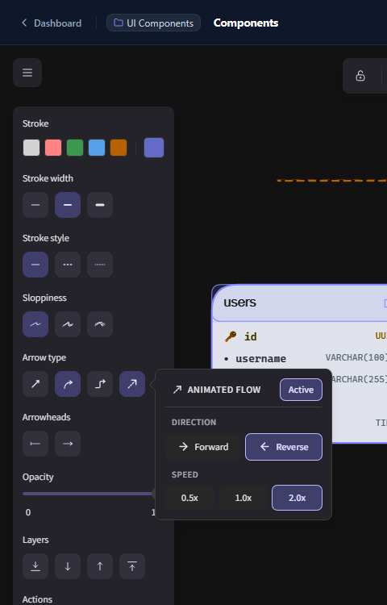
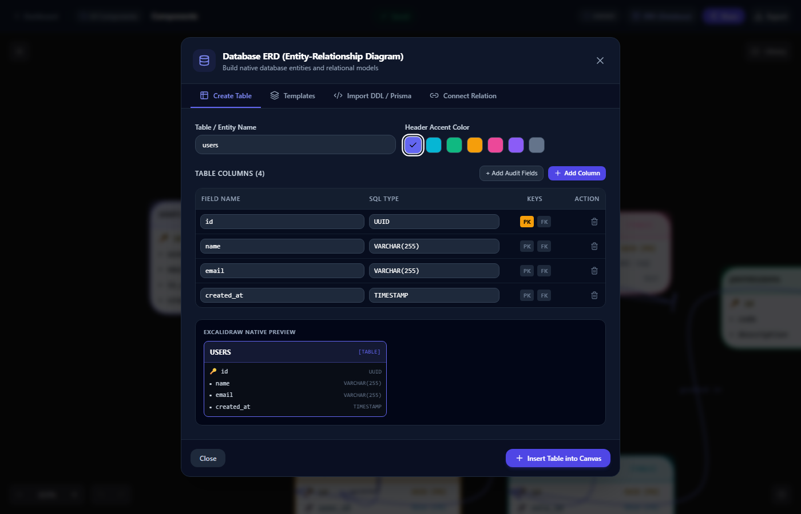
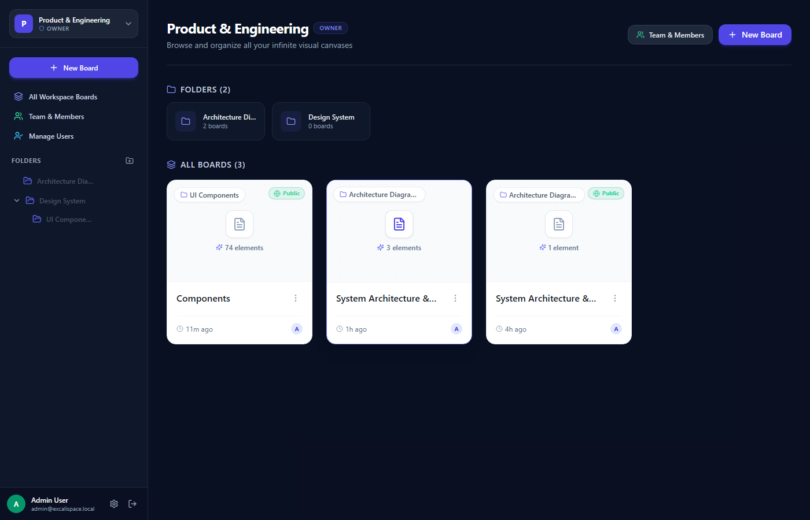
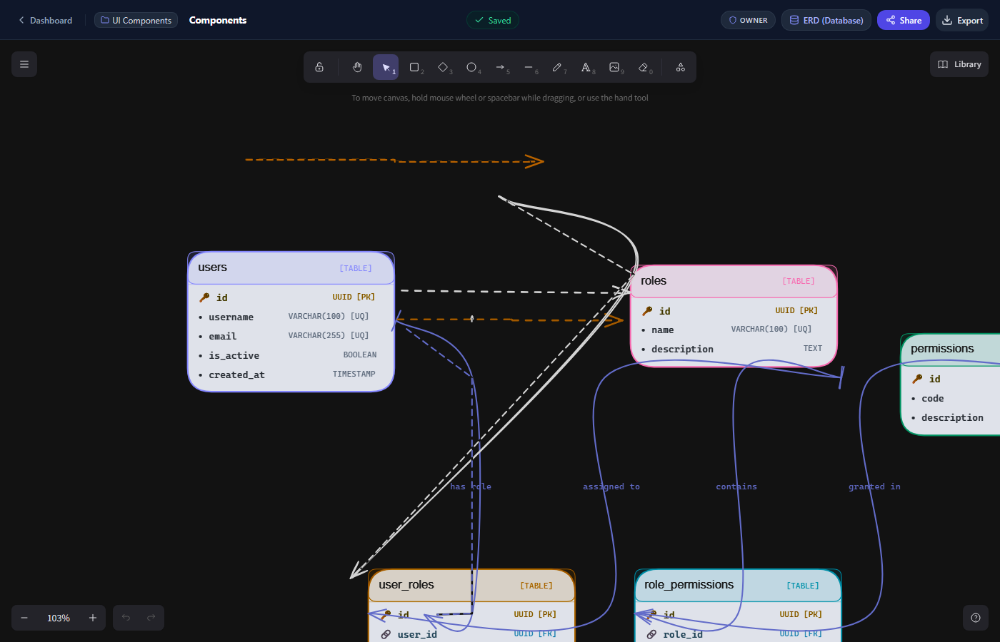
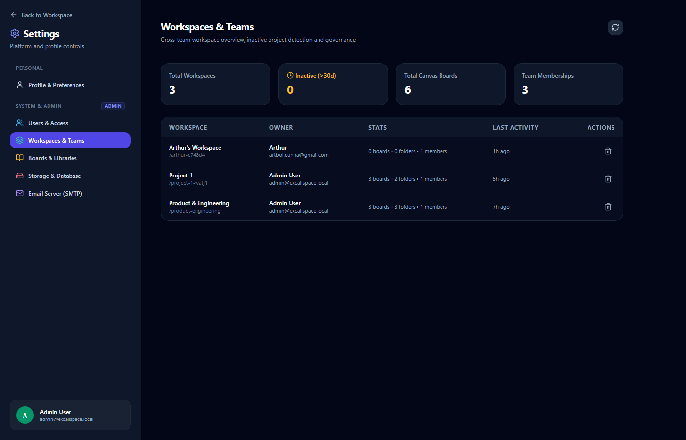
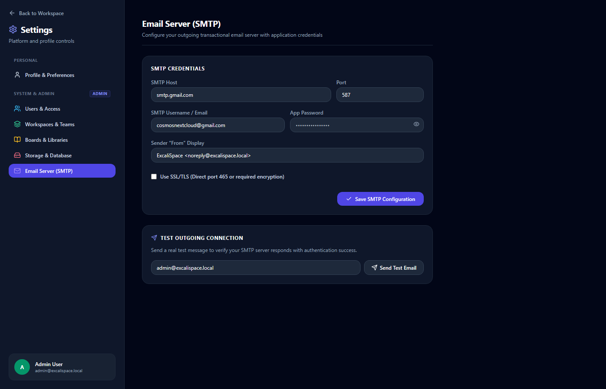

<div align="center">

# 🎨 ExcaliSpace

### Enterprise-Grade Self-Hosted Collaborative Canvas Workspace, Database ERD Modeler & Real-Time Flow Diagrams powered by Excalidraw.

[](https://hub.docker.com/r/rodrigodanieli/excalispace)
[](https://opensource.org/licenses/MIT)
[](https://nextjs.org/)
[](https://excalidraw.com/)
[](https://www.postgresql.org/)
[](https://www.prisma.io/)
[](https://www.typescriptlang.org/)

[Quick Start](#-quick-start-with-docker-hub) • [Key Features](#-key-features) • [Environment Variables](#-environment-variables) • [Production Deployment](#-production-deployment-guide) • [Docker Hub Publishing](#-publishing-to-docker-hub)

</div>

---

## 📸 Visual Showcase

<div align="center">

### 1. Infinite Canvas & Animated Data Flow
*Integrated directly into Excalidraw's native Arrow properties menu with real-time dash-offset animation, forward/reverse direction, and speed tuning.*



---

### 2. Native Database ERD Modeler & Instant Visual Generator
*Design relational entities with primary/foreign keys, import raw DDL / Prisma schemas, or insert pre-built architecture templates directly onto the canvas.*



---

### 3. Miro-Style Workspaces, Folders & Canvas Boards
*Hierarchical navigation tree with multi-tenant workspaces, folder nesting, drag & drop, and board access control.*



---

### 4. Canvas Board with Live Relational Entities & Data Flows
*High-performance infinite vector canvas with debounced auto-save, export options (PNG, SVG, JSON), and zoom controls.*



---

### 5. Enterprise Governance & Platform Administration
*Complete control panel for platform user roles, workspace analytics (including >30d inactive project detection), and storage usage.*



---

### 6. Transactional Email Server (SMTP) Dispatcher
*Built-in SMTP configuration with live connection testing, supporting Gmail App Passwords, Outlook, Amazon SES, and custom mail servers.*



</div>

---

## 🌟 Key Features

### 🏢 1. Miro-Style Organizational Hierarchy
* **Multi-Tenant Workspaces:** Create isolated workspaces with custom slugs (`/workspace-slug`) for different clients, squads, or projects.
* **Hierarchical Folders:** Organize infinite boards into nested directories with breadcrumbs and real-time folder tree navigation.
* **Smart Board Management:** Duplicate, move between folders, rename, and archive boards with instant updates.

### ⚡ 2. Custom Canvas Engine (`@excalidraw/excalidraw`)
* **SSR Bypass Architecture:** Dynamic client import (`next/dynamic`) bypassing Next.js server-side constraints.
* **Intelligent Auto-Save Debounce (1,600ms):** Automatically sanitizes transient cursor/pointer coordinates and persists clean vector JSONB structures directly to PostgreSQL.
* **Multi-Format Export:** Export your diagrams to high-res PNG, vector SVG, or native `.excalidraw` schema files.

### 🔄 3. Native Animated Flow Arrows
* **Seamless Excalidraw UI Integration:** Positioned directly alongside Excalidraw's native **Arrow Type** toolbar selector.
* **Native Popover Controls:** Configurable directional flow (*Forward* from Source to Target, or *Reverse* from Target to Source) and variable speed settings (*0.5x, 1.0x, 2.0x*).
* **Transparent Canvas Overlay:** Hardware-accelerated SVG dash-offset animation rendering on top of the native canvas without interfering with element dragging or right-click context menus.

### 🗄️ 4. Native Database ERD Modeler
* **Visual Table Builder:** Add tables, define field names, choose SQL data types (`UUID`, `VARCHAR`, `TIMESTAMP`, etc.), and flag `PK` (Primary Key) or `FK` (Foreign Key).
* **Instant DDL / Prisma Import:** Paste standard SQL `CREATE TABLE` statements or Prisma schema models, and watch ExcaliSpace parse them into native Excalidraw shapes.
* **Pre-Built Architectural Templates:** One-click insertion of industry schemas (*SaaS RBAC*, *E-Commerce & Orders*, *Authentication & Sessions*).

### 🛡️ 5. Role-Based Access Control (RBAC) & Sharing
| Role | View Boards | Edit Boards | Create Folders / Boards | Delete Folders / Boards | Workspace Admin |
|:---|:---:|:---:|:---:|:---:|:---:|
| **OWNER** | ✅ | ✅ | ✅ | ✅ | ✅ |
| **ADMIN** | ✅ | ✅ | ✅ | ✅ | ❌ |
| **EDITOR** | ✅ | ✅ | ✅ | ❌ | ❌ |
| **VIEWER** | ✅ | ❌ | ❌ | ❌ | ❌ |

* **Public Canvas Sharing:** Toggle 1-click public links with granular access control (*Read-Only Presentation* or *Anonymous Collaboration*).
* **Direct Collaborator Invitations:** Invite specific members by email with custom access rights.

---

## 🚀 Quick Start with Docker Hub

Deploy a production-ready ExcaliSpace instance in under 60 seconds using the pre-built Docker Hub image:

```bash
# 1. Download production docker compose and environment template
curl -O https://raw.githubusercontent.com/rodrigodanieli/excalipro/main/docker-compose.prod.yml
curl -O https://raw.githubusercontent.com/rodrigodanieli/excalipro/main/.env.example
cp .env.example .env

# 2. Start the stack (PostgreSQL 16 + ExcaliSpace Web App)
docker compose -f docker-compose.prod.yml up -d
```

Open [http://localhost:3001](http://localhost:3001) in your browser:
* **Default Admin Email:** `admin@excalispace.local`
* **Default Admin Password:** `password123`

*(Database schema migrations and seed data are automatically executed by the container entrypoint!)*

---

## 🛠️ Building & Running from Source

If you prefer building the container locally or developing directly:

### Option A: Local Docker Compose Build

```bash
# 1. Clone repository
git clone https://github.com/rodrigodanieli/excalipro.git
cd excalipro

# 2. Configure environment
cp .env.example .env

# 3. Build and launch
docker compose up --build -d
```

### Option B: Bare-Metal Node.js Development

```bash
# 1. Install dependencies
npm install

# 2. Set up local PostgreSQL and push schema
npm run db:push
npm run db:seed

# 3. Start development server
npm run dev -- -p 3001
```

---

## 🔐 Environment Variables

Configure your deployment by setting these variables in your `.env` file:

| Variable | Description | Default | Production Note |
|---|---|---|---|
| `NEXTAUTH_URL` | Public base URL of your platform | `http://localhost:3001` | Set to your actual domain (e.g. `https://canvas.mycompany.com`) |
| `NEXTAUTH_SECRET` | 32+ character key for JWT token encryption | `excalispace-secret` | **MUST** generate via `openssl rand -base64 32` |
| `APP_PORT` | Host port mapped to the web app | `3001` | Change if port 3001 is already bound on your host |
| `DATABASE_URL` | PostgreSQL connection string | `postgresql://postgres:postgres@db:5432/excalispace?schema=public` | Uses `db` host inside docker network |
| `POSTGRES_USER` | PostgreSQL superuser username | `postgres` | Recommended to change for production |
| `POSTGRES_PASSWORD` | PostgreSQL superuser password | `postgres` | Recommended to change for production |
| `POSTGRES_DB` | PostgreSQL database name | `excalispace` | Database name |
| `STORAGE_DRIVER` | Asset storage adapter (`local` or `s3`) | `local` | Set `s3` for MinIO or AWS S3 |
| `STORAGE_LOCAL_PATH` | Storage directory inside container | `/app/public/uploads` | Mounted to Docker volume `excalispace_uploads` |
| `SMTP_HOST` | Outgoing SMTP mail server | `""` | e.g. `smtp.gmail.com`, `smtp.office365.com` |
| `SMTP_PORT` | SMTP port | `587` | `587` for STARTTLS, `465` for SSL |
| `SMTP_USER` | SMTP username / sender address | `""` | Your authenticated email address |
| `SMTP_PASSWORD` | SMTP password or App Password | `""` | 16-character App Password for Gmail |
| `SMTP_SECURE` | Force direct SSL connection | `false` | `true` for port 465, `false` for port 587 |
| `SMTP_FROM` | Outgoing email header sender string | `"ExcaliSpace <noreply@excalispace.local>"` | Display name and return address |
| `GITHUB_ID` / `GITHUB_SECRET` | GitHub OAuth credentials *(Optional)* | `""` | Set up at [GitHub Developer Settings](https://github.com/settings/developers) |
| `GOOGLE_CLIENT_ID` / `GOOGLE_CLIENT_SECRET` | Google OAuth credentials *(Optional)* | `""` | Set up at [Google Cloud Console](https://console.cloud.google.com/) |

---

## 🐳 Publishing to Docker Hub

You can publish images manually via the CLI or automatically using GitHub Actions.

### 1. Automated via GitHub Actions (Recommended)

This repository includes a production workflow at [`.github/workflows/docker-publish.yml`](.github/workflows/docker-publish.yml) that automatically builds multi-arch images (`linux/amd64` and `linux/arm64`) on every release tag or push to `main`.

**Setup:**
1. In your GitHub repository, navigate to **Settings > Secrets and variables > Actions**.
2. Add two repository secrets:
   * `DOCKERHUB_USERNAME`: Your Docker Hub username (`rodrigodanieli`).
   * `DOCKERHUB_TOKEN`: A Docker Hub Personal Access Token (generate at [Docker Hub Account Settings](https://hub.docker.com/settings/security)).
3. Push a new tag:
   ```bash
   git tag v1.0.0
   git push origin v1.0.0
   ```

### 2. Manual CLI Publishing

Use the provided helper scripts or run standard Docker commands:

#### On Windows (PowerShell):
```powershell
.\scripts\publish-dockerhub.ps1 -Tag "latest" -DockerUser "rodrigodanieli"
```

#### On Linux / macOS:
```bash
chmod +x ./scripts/publish-dockerhub.sh
./scripts/publish-dockerhub.sh latest rodrigodanieli
```

#### Manual Docker CLI:
```bash
# 1. Login to Docker Hub
docker login

# 2. Build multi-stage image
docker build -f docker/Dockerfile -t rodrigodanieli/excalispace:latest .

# 3. Push to registry
docker push rodrigodanieli/excalispace:latest
```

---

## 🌐 Production Deployment Guide

### Reverse Proxy Configuration (Nginx)

When exposing ExcaliSpace on a public domain with HTTPS/SSL:

```nginx
server {
    server_name canvas.yourdomain.com;

    location / {
        proxy_pass http://127.0.0.1:3001;
        proxy_http_version 1.1;
        proxy_set_header Upgrade $http_upgrade;
        proxy_set_header Connection 'upgrade';
        proxy_set_header Host $host;
        proxy_set_header X-Real-IP $remote_addr;
        proxy_set_header X-Forwarded-For $proxy_add_x_forwarded_for;
        proxy_set_header X-Forwarded-Proto $scheme;
        proxy_cache_bypass $http_upgrade;
        
        # Support large canvas image uploads
        client_max_body_size 50M;
    }

    listen 443 ssl http2;
    ssl_certificate /etc/letsencrypt/live/canvas.yourdomain.com/fullchain.pem;
    ssl_certificate_key /etc/letsencrypt/live/canvas.yourdomain.com/privkey.pem;
}
```

### Database Backup & Restore

```bash
# Backup PostgreSQL database to a timestamped file
docker exec -t excalispace-db pg_dump -U postgres excalispace > backup_$(date +%Y%m%d_%H%M%S).sql

# Restore database from backup
cat backup.sql | docker exec -i excalispace-db psql -U postgres -d excalispace
```

---

## 🏗️ Architecture & Technology Stack

```text
├── .github/
│   └── workflows/
│       └── docker-publish.yml     # Automated Docker Hub multi-arch build CI/CD
├── docker/
│   ├── Dockerfile                 # Optimized multi-stage production build (Alpine + Standalone)
│   ├── entrypoint.sh              # DB wait, schema synchronization, and auto-seeding
│   └── docker-compose.yml         # Development compose configuration
├── docs/
│   └── screenshots/               # High-resolution screenshots showcase
├── prisma/
│   ├── schema.prisma              # Relational schema (Users, Workspaces, Folders, Boards)
│   └── seed.js                    # Database seeder (Admin account, sample schemas)
├── scripts/
│   ├── publish-dockerhub.sh       # Linux/macOS Docker Hub publishing script
│   └── publish-dockerhub.ps1      # Windows PowerShell Docker Hub publishing script
├── src/
│   ├── app/                       # Next.js 14 App Router (Settings, Boards, Workspaces, Auth)
│   ├── components/                # React & Excalidraw UI components
│   │   ├── canvas/
│   │   │   ├── ExcalidrawWrapper.tsx        # Canvas loader & auto-save engine
│   │   │   ├── NativeArrowAnimationPanel.tsx # Arrow popover & animation engine
│   │   │   └── DatabaseERDModal.tsx         # Database schema modeler & DDL converter
│   │   └── dashboard/                       # Folder tree, board cards, member modal
│   └── lib/                       # Prisma client, Nodemailer, NextAuth, ERD generators
├── docker-compose.yml             # Local development Docker Compose
├── docker-compose.prod.yml        # 1-Click production Docker Hub Compose
├── .env.example                   # Documented configuration template
└── README.md                      # Project documentation
```

---

## 📄 License

This project is licensed under the [MIT License](LICENSE). Open-source, self-hosted, and designed for team freedom.

Developed with ❤️ by [Rodrigo Danieli](https://github.com/rodrigodanieli).
